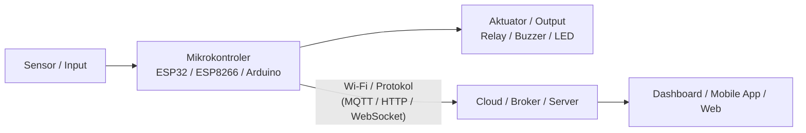

# 🌐 Proyek Internet of Things (IoT)

> **Catatan:** Dokumen ini merupakan template awal/umum (general) untuk proyek IoT. Silakan sesuaikan detail sensor, mikrokontroler, dan platform yang digunakan.

---

## 📌 Deskripsi Proyek
Proyek ini merupakan sistem berbasis **Internet of Things (IoT)** yang dirancang untuk melakukan pemantauan (*monitoring*) dan/atau pengendalian (*controlling*) perangkat secara *real-time* dan jarak jauh melalui jaringan internet.

---

## ✨ Fitur Utama
- **Real-Time Data Monitoring:** Pengambilan data sensor secara periodik dan akurat.
- **Remote Control / Actuation:** Kendali perangkat (relay, motor, lampu, dll.) melalui internet/aplikasi.
- **Konektivitas Cloud / Broker:** Pengiriman data menggunakan protokol komunikasi IoT yang ringan dan handal.
- **Dashboard Visualisasi:** Antarmuka visual (Web / Mobile / Dashboard IoT) untuk memantau status sistem.
- **Notifikasi & Alert (Opsional):** Peringatan otomatis jika parameter sensor melewati ambang batas tertentu.

---

## 🏗️ Arsitektur Sistem



---

## 🛠️ Kebutuhan Hardware & Software

### 1. Hardware (Perangkat Keras)
*Sesuaikan dengan komponen yang digunakan:*
- **Mikrokontroler:** ESP32 / ESP8266 NodeMCU / Arduino Uno + WiFi Shield
- **Sensor:** *(Contoh: DHT11/DHT22, Ultrasonik HC-SR04, LDR, PIR, MQ-series, dll.)*
- **Aktuator:** *(Contoh: Modul Relay 5V, Servo SG90, Buzzer, LED)*
- **Aksesoris:** Breadboard, Kabel Jumper (Male-to-Male / Male-to-Female), Kabel Micro-USB / Type-C, Power Supply / Adaptor

### 2. Software & Platform
- **IDE / Editor:** [Arduino IDE](https://www.arduino.cc/) / [PlatformIO (VS Code)](https://platformio.org/)
- **Library Pendukung:** *(Contoh: `WiFi.h`, `PubSubClient`, `Adafruit Unified Sensor`, `DHT sensor library`, `ArduinoJson`)*
- **Protokol & Server:** MQTT (HiveMQ / Mosquitto / EMQX) atau HTTP/REST
- **Platform IoT / Dashboard:** ThingsBoard / Blynk / Adafruit IO / Firebase / Custom Web App

---

## 🔌 Skema Rangkaian (Wiring Pinout)

| Komponen | Pin Mikrokontroler | Keterangan |
| :--- | :--- | :--- |
| **VCC Sensor** | 3.3V / 5V | Sumber daya |
| **GND Sensor** | GND | Ground bersama |
| **Data Sensor** | GPIO XX (DXX) | Input sinyal sensor |
| **Control Pin Aktuator** | GPIO YY (DYY) | Output sinyal kontrol (Relay/LED) |

> *(Sertakan gambar skema rangkaian Fritzing / diagram breadboard di folder `assets/` jika ada)*

---

## 🚀 Panduan Instalasi & Menjalankan

### 1. Persiapan Environment
1. Unduh dan pasang **Arduino IDE** atau **VS Code** dengan ekstensi **PlatformIO**.
2. Pasang board driver (CH340 / CP210x jika diperlukan).
3. Tambahkan Board Manager URL untuk ESP32/ESP8266:
   - Masuk ke **Preferences** di Arduino IDE dan tambahkan URL board yang relevan.
4. Pasang library yang dibutuhkan melalui **Library Manager**.

### 2. Konfigurasi Program
Buka file program utama (`main.ino` atau `src/main.cpp`), lalu sesuaikan konfigurasi jaringan dan kredensial:
```cpp
// Konfigurasi Wi-Fi
const char* ssid     = "NAMA_WIFI_ANDA";
const char* password = "PASSWORD_WIFI";

// Konfigurasi Broker / Server IoT (jika menggunakan MQTT/Platform)
const char* mqtt_server = "broker.hivemq.com";
const int   mqtt_port   = 1883;
```

### 3. Upload Program
1. Hubungkan mikrokontroler ke komputer menggunakan kabel data USB.
2. Pilih port COM dan jenis board yang sesuai.
3. Klik tombol **Upload / Flash**.
4. Buka **Serial Monitor** (set baud rate sesuai kode, misal `115200` atau `9600`) untuk melihat log inisialisasi dan status koneksi.

---

## 📂 Struktur Direktori

```text
tugasIOT/
├── docs/                 # Dokumentasi, skema rangkaian, dan laporan
│   └── wiring-diagram.png
├── src/                  # Kode sumber firmware / mikrokontroler
│   ├── main.ino          # File utama sketch Arduino/ESP
│   └── config.h          # Konfigurasi WiFi, pin, dan server
├── dashboard/            # (Opsional) Kode antarmuka web / dashboard lokal
├── .gitignore            # File yang diabaikan oleh Git
└── README.md             # Dokumentasi utama proyek
```

---

## 👥 Tim & Pengembang
- **Nama Mahasiswa / Pengembang:** [Nama Anda]
- **NIM:** [NIM Anda]
- **Program Studi / Mata Kuliah:** [Internet of Things / Teknik Informatika / Sistem Komputer]

---

## 📄 Lisensi
Proyek ini dibuat untuk keperluan akademik/tugas mata kuliah Internet of Things (IoT).
